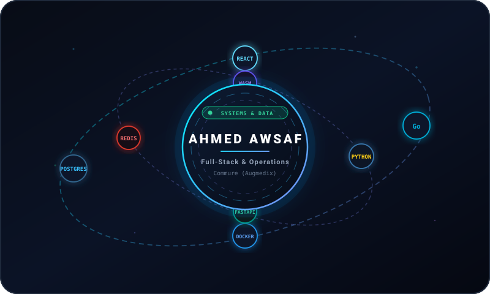
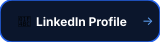
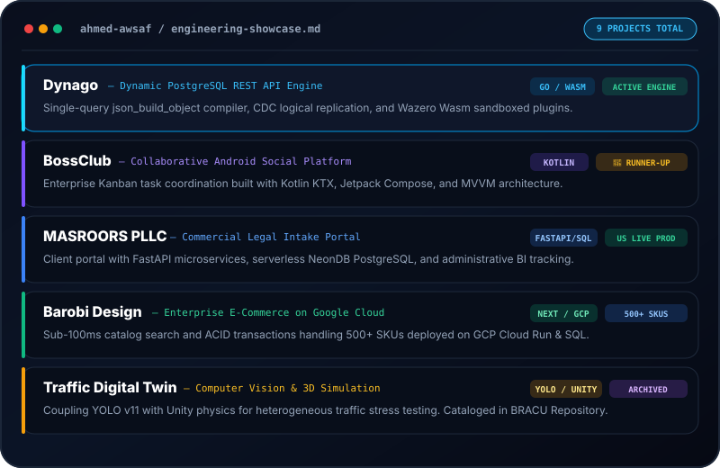

# GitHub Profile README Snippet & Mini-Widgets — Ahmed Awsaf

This file contains copy-paste ready snippets for your GitHub Profile (`username/username` repository `README.md`).

All components are **100% compatible with GitHub's Markdown & Camo renderer**.

---

## 📋 Copy-Paste Profile README Template

```markdown
<div align="center">

  <!-- ==================== COMPONENT 1: ORBIT WITH AHMED AWSAF ==================== -->
  <a href="https://github.com/AhmedAwsaf">
    
  </a>

  <br />
  <br />

  <!-- ==================== COMPONENT 3: TACTILE BUTTON GROUPS ==================== -->
  <p align="center">
    <a href="https://ahmedawsaf.github.io/portfolio/">
      
    </a>
    &nbsp;
    <a href="https://github.com/dynago/dynago">
      
    </a>
    &nbsp;
    <a href="https://raw.githubusercontent.com/AhmedAwsaf/Personal-Portfolio/main/public/content/CV___Remote.pdf">
      
    </a>
    &nbsp;
    <a href="https://www.linkedin.com/in/awsaf-ahmed/">
      
    </a>
    &nbsp;
    <a href="https://ahmedawsaf.github.io/portfolio/?widget=game">
      
    </a>
  </p>

  <br />

  <!-- ==================== COMPONENT 2: NICE PROJECTS LIST ==================== -->
  <a href="https://ahmedawsaf.github.io/portfolio/#projects">
    
  </a>

</div>
```

---

## 🎮 Dynamic URL Parameter Deep-Links

When your portfolio is deployed on GitHub Pages or Vercel, the application supports dedicated fullscreen widget modes via URL search parameters:

| URL Parameter | What It Opens |
|:---|:---|
| `?widget=orbit` | Opens the 3D Orbiting Tech Rings with `AHMED AWSAF` center core and mouse parallax. |
| `?widget=game` | Launches the playable 2D Space Shooter arcade in fullscreen with zero distractions. |
| `?widget=projects` | Opens the minimalist projects showcase card. |
| *(no param)* | Loads your complete full-featured portfolio website. |

---

## 📁 Widget Assets Inventory

All vector assets are stored in:
- `public/content/readme-widgets/`
- `content/readme-widgets/`

| File | Purpose |
|:---|:---|
| [`orbit.svg`](./readme-widgets/orbit.svg) | Component 1: Animated 3D orbit with "AHMED AWSAF" in center |
| [`projects-list.svg`](./readme-widgets/projects-list.svg) | Component 2: High-aesthetic projects list card |
| [`button-group.svg`](./readme-widgets/button-group.svg) | Component 3: Complete horizontal button toolbar |
| [`btn-portfolio.svg`](./readme-widgets/btn-portfolio.svg) | Clickable pill: Live Portfolio |
| [`btn-dynago.svg`](./readme-widgets/btn-dynago.svg) | Clickable pill: Dynago Engine |
| [`btn-cv.svg`](./readme-widgets/btn-cv.svg) | Clickable pill: Resume PDF |
| [`btn-linkedin.svg`](./readme-widgets/btn-linkedin.svg) | Clickable pill: LinkedIn |
| [`btn-game.svg`](./readme-widgets/btn-game.svg) | Clickable pill: Play Space Arcade |

