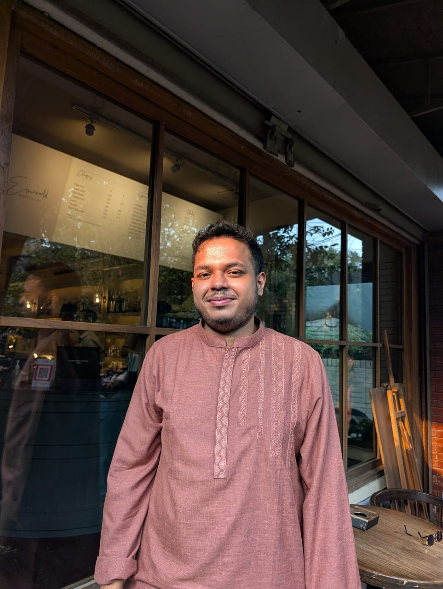

# About Ahmed Awsaf

## 📌 Introduction

I am a **Software Engineer** and **Data Analyst** with around 4 years of experience building production-grade APIs, high-throughput data pipelines, and automated workflow solutions. Combining a solid computer science background with hands-on expertise in artificial intelligence, backend web systems, and data analytics, I specialize in translating complex real-world challenges into reliable, high-performance software.

Currently, I serve as an **Operations Analyst, Growth Operations** at **Commure Bangladesh (Augmedix)** in Dhaka, contributing to revenue benchmarking operations, automated reporting workflows, and clinical AI quality control.

---

## 💡 Mission & Engineering Philosophy

- **Technology for Social Impact:** Passionate about utilizing software, AI, and data science to improve outcomes for underserved communities, healthcare patients, and civic infrastructure.
- **Data Integrity & Automation First:** Committed to eliminating tedious manual overhead by designing self-healing, automated verification loops and robust testing harnesses.
- **Full-Stack Craftsmanship:** Deep appreciation for end-to-end design—from crafting fluid, responsive interfaces (Next.js, React, Tailwind CSS) to architecting low-latency server APIs (FastAPI, Express.js, PostgreSQL).
- **Practical Applied Machine Learning:** Experienced in deploying state-of-the-art vision and sequence models (YOLO v11, Computer Vision, Digital Twin simulations) to solve physical and operational problems.

---

## 🌐 Contact & Online Presence

- **Email:** [officialawsaf@gmail.com](mailto:officialawsaf@gmail.com)
- **Phone:** [+8801632663362](tel:+8801632663362)
- **Location:** Niketan, Dhaka, Bangladesh
- **LinkedIn:** [linkedin.com/in/awsaf-ahmed/](https://www.linkedin.com/in/awsaf-ahmed/)
- **GitHub:** [github.com/AhmedAwsaf](https://github.com/AhmedAwsaf)
- **CV Download:** [Download PDF Version](./cv/CV___Remote.pdf)

---

## 🎨 Visual Identity

Ahmed's personal branding features stylized portraits and custom avatars:

| Real Portrait | Stylized Character 1 | Stylized Character 2 |
| :---: | :---: | :---: |
|  |  |  |
