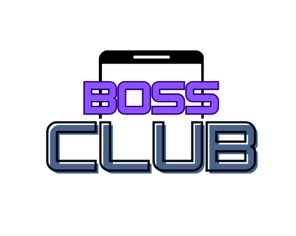
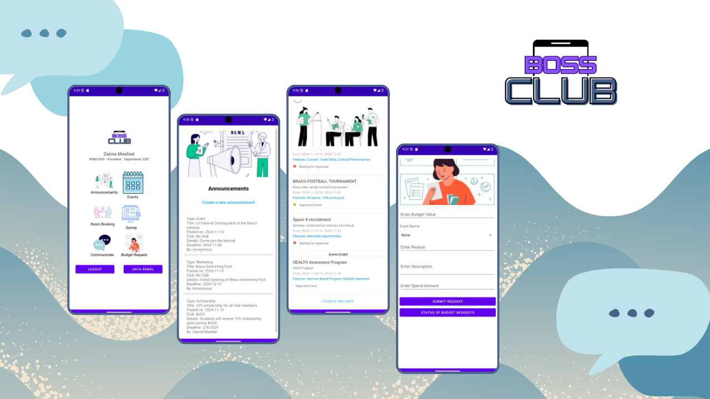
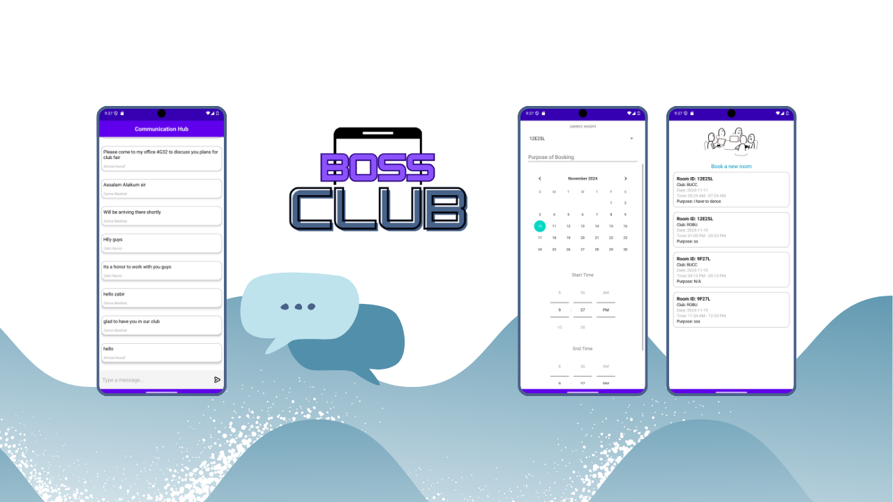
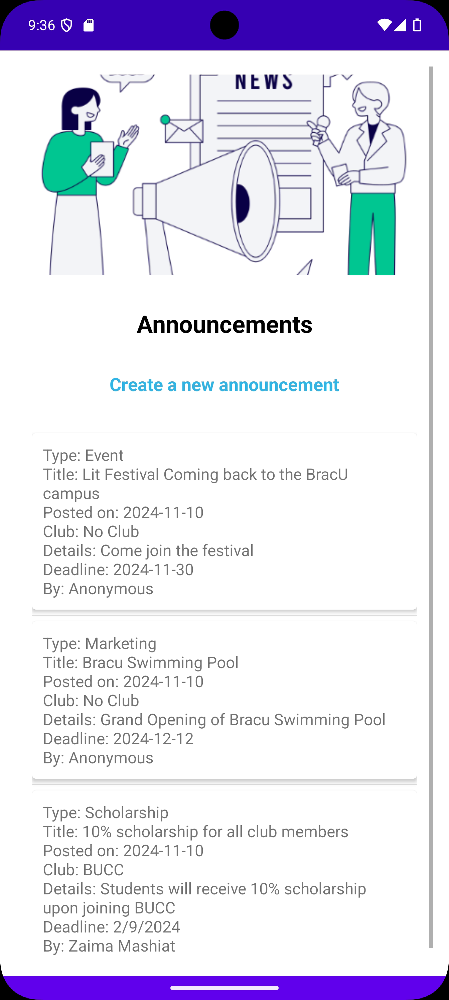
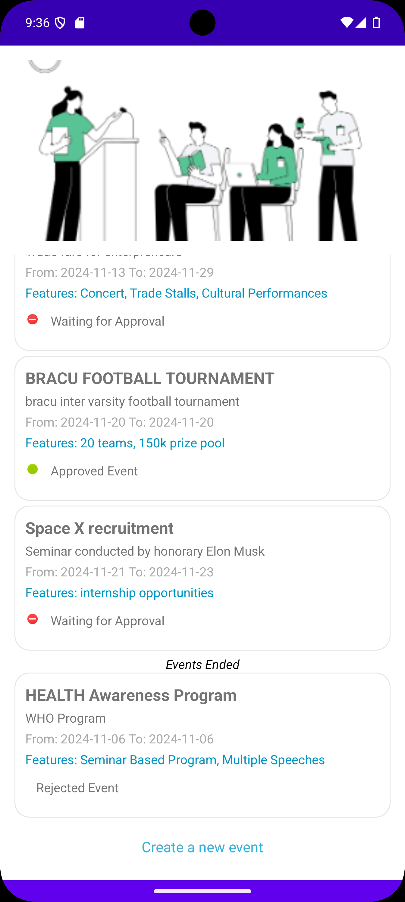
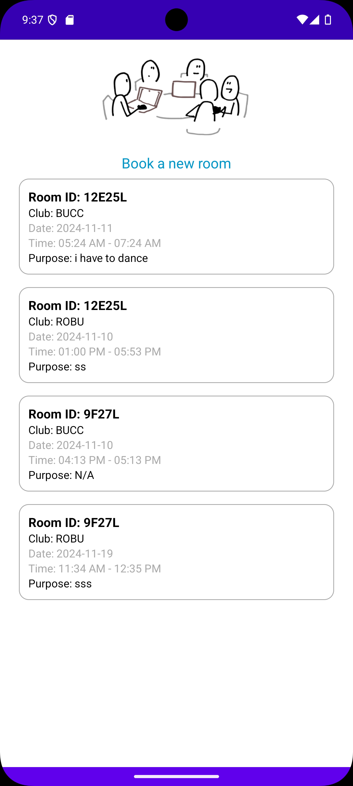
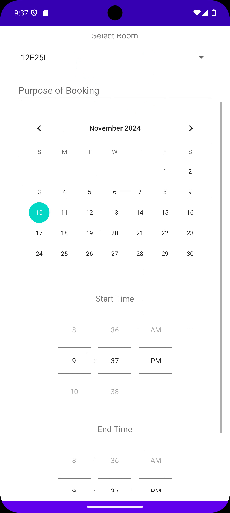
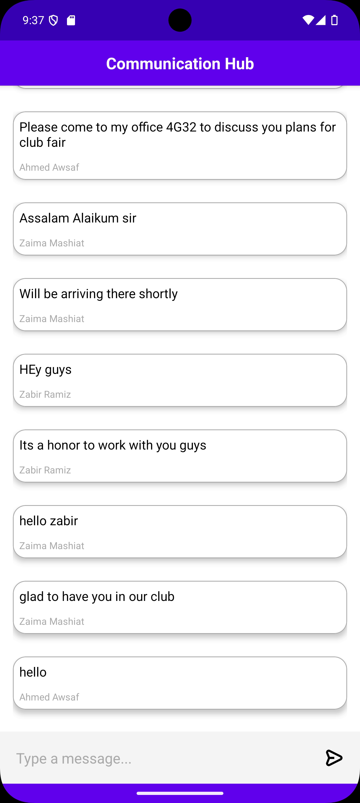
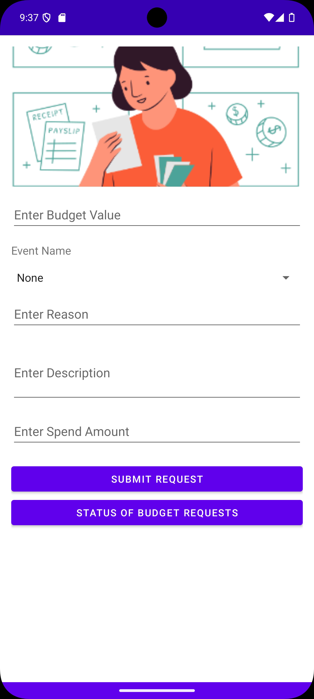
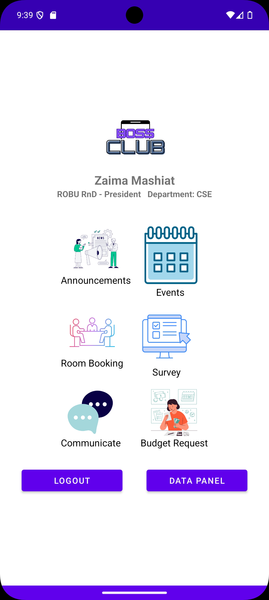

# BossClub — IntraHacktive 1.0 (Second Runner-Up)

## 📌 Project Overview

**BossClub** is an enterprise social networking and collaborative task management Android mobile application designed to connect professionals within an organization. Built during the **IntraHacktive 1.0** hackathon, the app placed **Second Runner-Up** among stiff university competition.

The platform eliminates departmental friction through a unified mobile interface that integrates direct peer messaging, team event scheduling, project milestones, and real-time task assignment.

---

## 🔗 Key Links & Information

- **GitHub Repository:** [github.com/AhmedAwsaf/BossClub_IntraHacktive_T13](https://github.com/AhmedAwsaf/BossClub_IntraHacktive_T13)
- **Author & Lead Developer:** Ahmed Awsaf
- **Collaborators:**
  - [Ahmed Awsaf](https://www.linkedin.com/in/awsaf-ahmed)
  - [Zaima Mashiat](https://github.com/zaimamashiat)
  - [Abrar Jahin Alvee](https://github.com/zaimamashiat)
- **Award:** 🥉 **Second Runner-Up** at BRACU IntraHacktive 1.0 Hackathon (2024)

---

## 🛠️ Technical Architecture

- **Operating System:** Android (API 26+)
- **Primary Language:** Kotlin (with Kotlin KTX extensions)
- **UI Toolkit:** Jetpack Compose (Modern declarative UI)
- **Architecture Pattern:** MVVM (Model-View-ViewModel) with Unidirectional Data Flow (UDF)
- **Asynchronous Operations:** Kotlin Coroutines & StateFlow
- **Component Design:** Material Design 3 guidelines with adaptive dark and light themes

---

## ✨ Core Features

1. **Intra-Organizational Feed:** Company announcements, departmental posts, interactive comments, and peer recognition.
2. **Real-Time Collaboration & Chat:** Low-latency 1-on-1 and channel messaging for project updates.
3. **Task & Milestone Management:** Interactive Kanban-style task tracking with status badges (To Do, In Progress, Review, Completed).
4. **Calendar & Event Scheduling:** Integrated schedule for all-hands meetings, project sprints, and team deadlines.
5. **Fluid Declarative Animations:** Custom Compose transitions for modal sheets, drawer navigation, and item cards.

---

## 📸 Media & Screenshots

### Interface Highlights

| Screen 1: Dashboard | Screen 2: Task Board | Screen 3: Details |
| :---: | :---: | :---: |
|  |  |  |

| Screen 4: Schedule | Screen 5: Profile & Chat | Screen 6: Team Feed |
| :---: | :---: | :---: |
|  |  |  |

| Screen 7: Activities | Screen 8: Settings | Screen 9: Overview |
| :---: | :---: | :---: |
|  |  |  |

### Video Walkthrough
- Video demo file saved in project archive: `../images/projects/BossClub/10.mp4`
