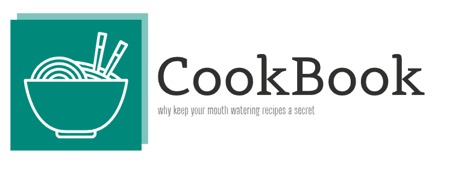
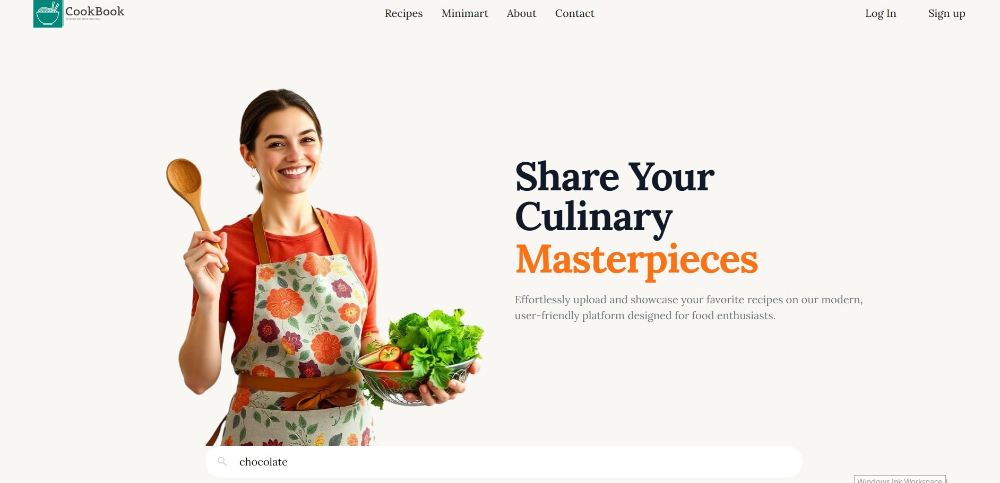
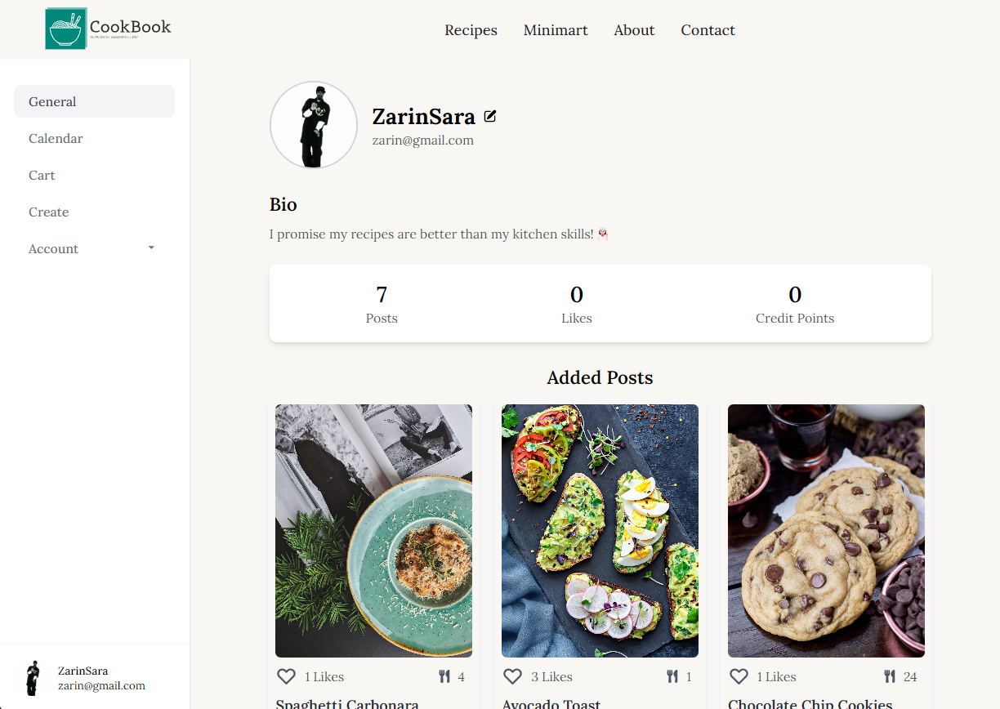
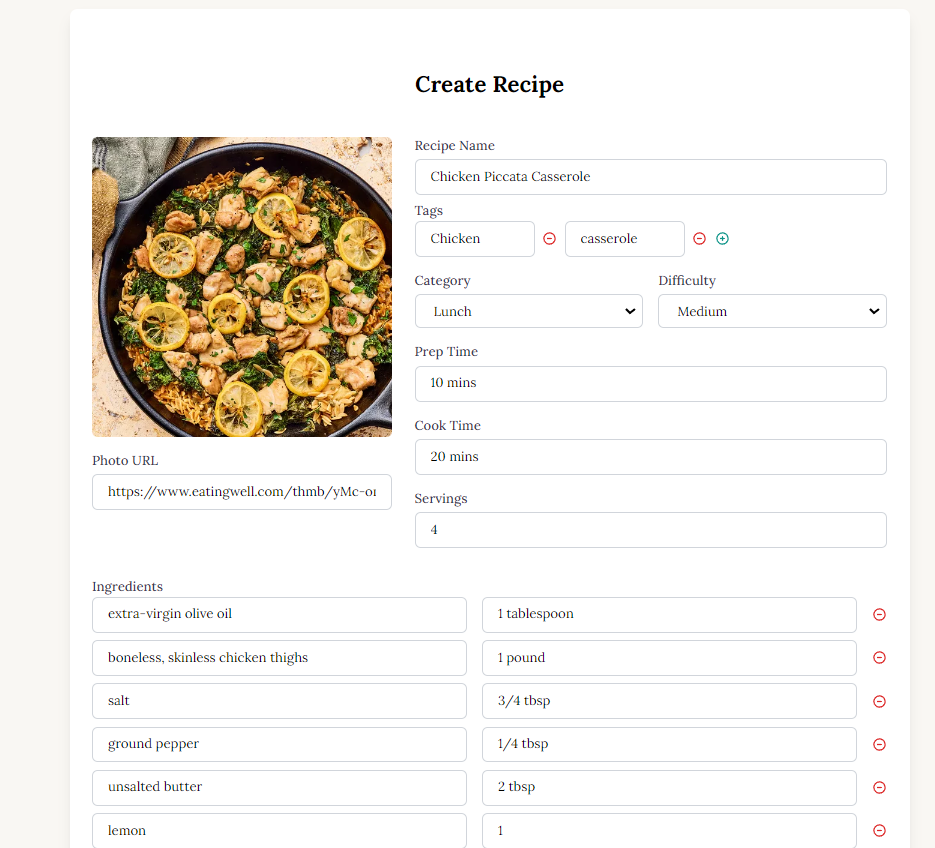
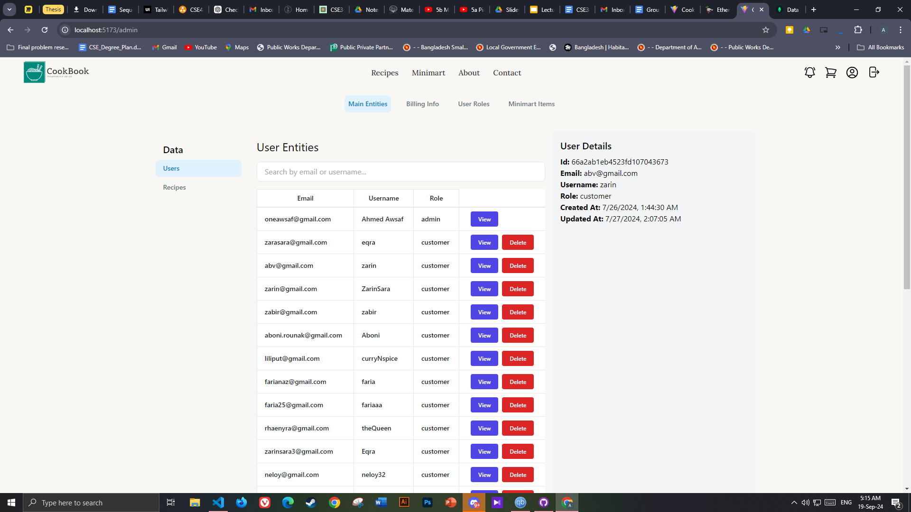
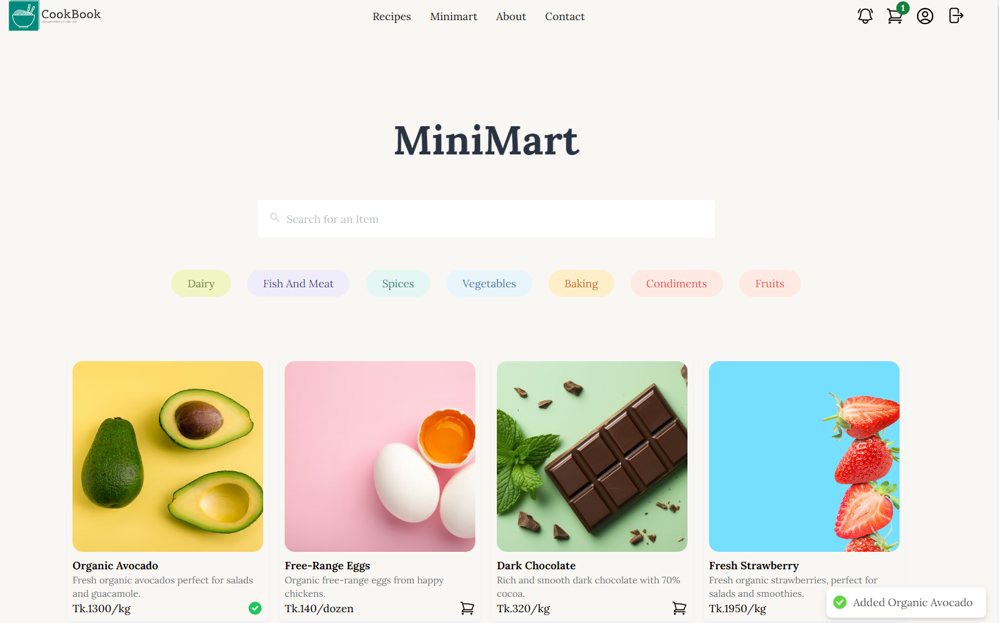

# CookBook — Full-Stack Recipe & Culinary Web Application

## 📌 Project Overview

**CookBook** is a full-stack recipe discovery and culinary sharing web application built using the modern **MERN stack** (MongoDB, Express.js, React.js, Node.js). It empowers home cooks and culinary enthusiasts to discover diverse cuisines, search dishes by ingredient availability, save favorites to personalized digital collections, and publish step-by-step culinary guides with rich photos and nutritional facts.

The platform emphasizes speed, responsive search indexing, and a clean, clutter-free user interface that stays readable in kitchen environments.

---

## 🔗 Key Links & Information

- **Live Application:** [cookbook-bay-chi.vercel.app](https://cookbook-bay-chi.vercel.app/)
- **GitHub Repository:** [github.com/AhmedAwsaf/CookBook](https://github.com/AhmedAwsaf/CookBook)
- **Author & Full-Stack Developer:** Ahmed Awsaf
- **Collaborators:**
  - [Ahmed Awsaf](https://www.linkedin.com/in/awsaf-ahmed)
  - [Zarin Saiyara Eqra](https://github.com/Eqrasyara)
  - [Tayeba Rounak Aboni](https://github.com/TayebaRounak)

---

## 🛠️ Technical Architecture

- **Frontend:** React.js, React Router, HTML5, CSS3, Modern State Management
- **Backend Server:** Node.js runtime, Express.js REST API framework
- **Database:** MongoDB (Cloud Atlas) with Mongoose ODM schemas
- **Authentication:** User session management, secure password hashing (bcrypt), JWT tokens
- **Deployment:** Vercel (Frontend Client) & Cloud API host

---

## ✨ Key Features

1. **Intelligent Recipe Search & Filtering:** Filter dishes by cuisine type, dietary restrictions (vegan, gluten-free, keto), cooking duration, or ingredients on hand.
2. **Interactive Recipe Publisher:** Intuitive form allowing cooks to list ingredients, specify fractional measurements, upload dish photos, and provide sequential cooking instructions.
3. **Personalized Recipe Box & Bookmarks:** Logged-in users can bookmark community recipes and organize them into custom meal collections.
4. **Responsive Across Devices:** Mobile and tablet-friendly layouts optimized for cooking at the kitchen counter.

---

## 📸 Media & Screenshots

| Home Page & Categories | Recipe Search View |
| :---: | :---: |
|  |  |

| Recipe Detail View | Preparation Steps | Ingredient List |
| :---: | :---: | :---: |
|  |  |  |
