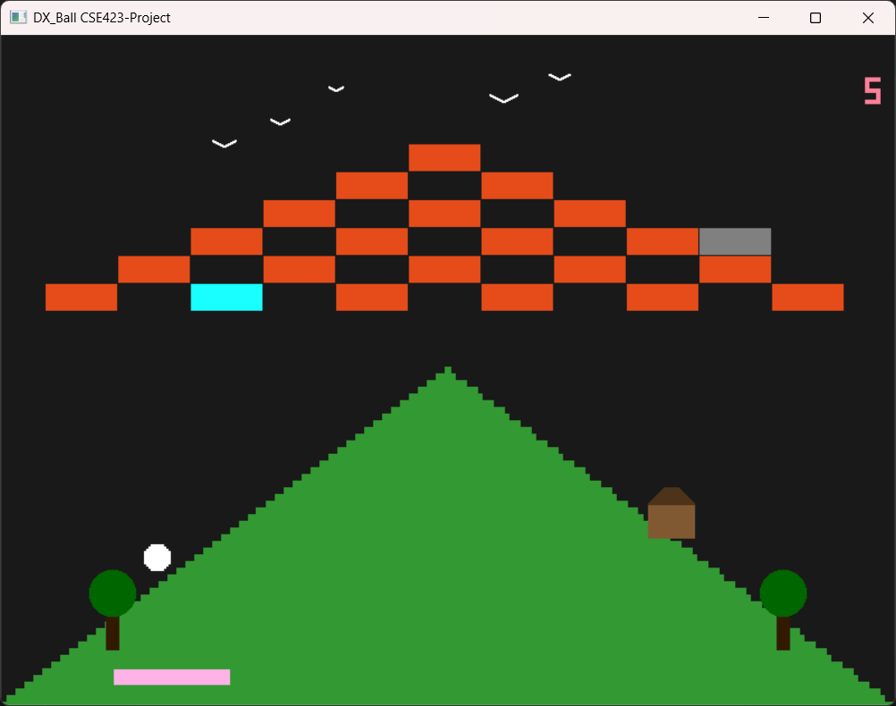
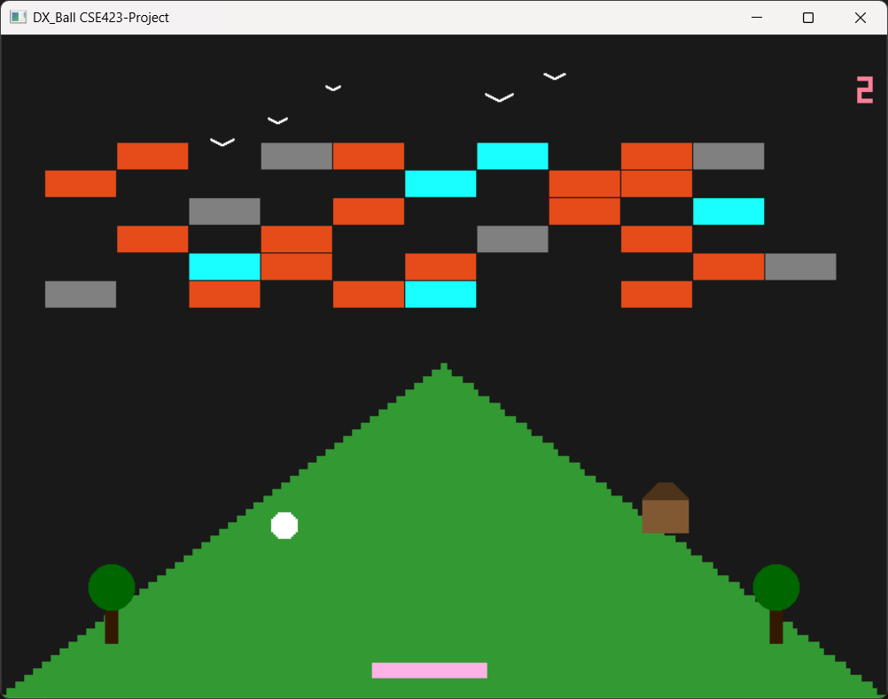

# DX Ball Game — Python & OpenGL Graphics Engine

## 📌 Project Overview

**DX Ball Game** is a modern reimagining of the iconic retro arcade brick-breaker game, implemented in **Python** using direct **OpenGL** graphics pipeline bindings. Rather than relying on high-level pre-built commercial game engines (like Unity or Unreal), this project was built from scratch to demonstrate low-level computer graphics principles, rasterization, frame buffers, and vector mathematics for collision detection.

---

## 🔗 Key Links & Information

- **GitHub Profile:** [github.com/AhmedAwsaf](https://github.com/AhmedAwsaf)
- **Author & Graphics Programmer:** Ahmed Awsaf
- **Core Technologies:** Python, PyOpenGL, GLFW / GLUT, Vector Mathematics

---

## 🛠️ Technical Implementation

- **Low-Level Graphics Pipeline:** Directly programmed OpenGL primitive drawing routines (quads, circles, lines) to render bricks, the player paddle, balls, and particle sparks.
- **Physics Engine from Scratch:** Developed custom 2D axis-aligned bounding box (AABB) and circle-to-box collision detection algorithms with mathematical reflection angle calculation based on paddle point-of-impact.
- **Game State Machine:** Implemented tick-based game loops handling frame timing, score tracking, multi-ball mechanics, and game-over conditions.
- **Shader & Color Lighting:** Applied custom color gradients and visual lighting effects to bricks to mimic the nostalgic look and feel of the original DX-Ball classic.

---

## 📸 Media & Screenshots

| Gameplay Screenshot 1 | Gameplay Screenshot 2 |
| :---: | :---: |
|  |  |
