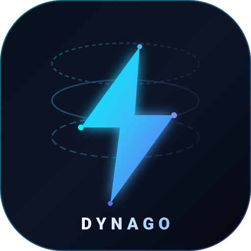
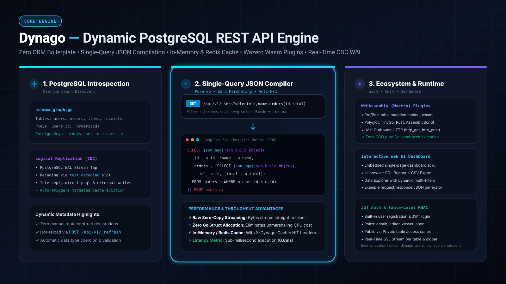
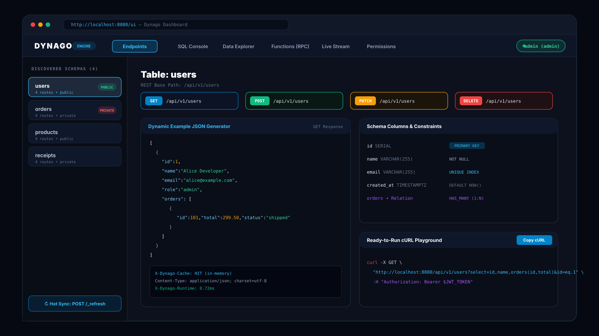
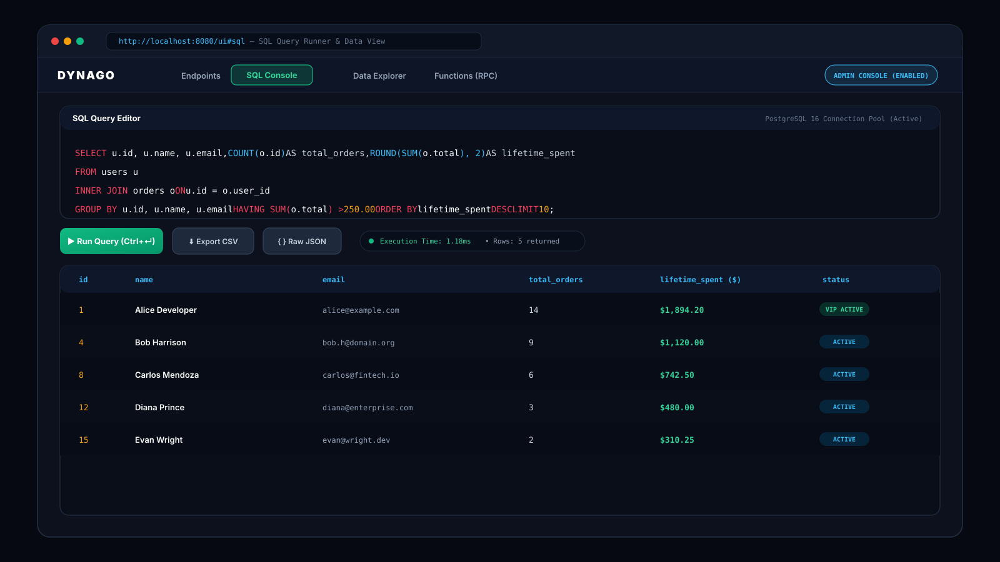
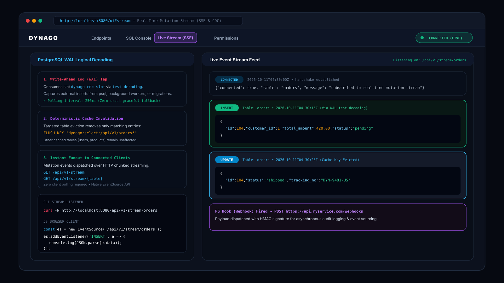
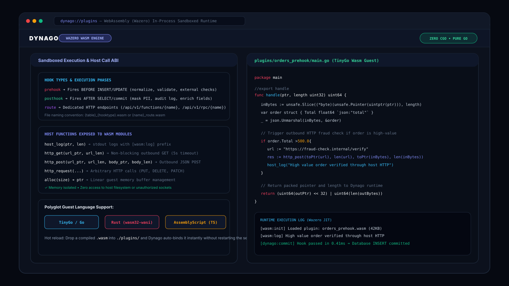
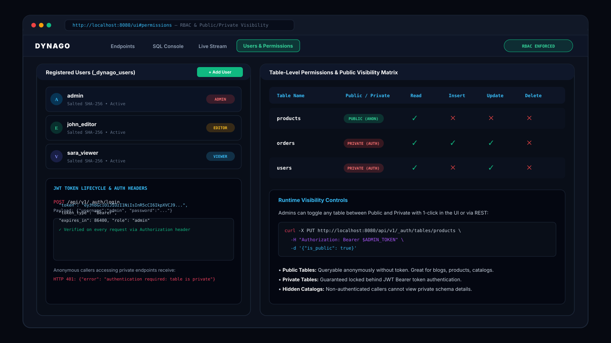

# Dynago — Dynamic PostgreSQL REST API Engine

## 📌 Project Overview

**Dynago** is a high-performance, dynamic PostgreSQL REST API engine written in Go. It connects to any PostgreSQL database and instantly exposes fully dynamic, cached REST endpoints for every table with **zero ORM, zero code generation, and zero boilerplate**.

Dynago introspects the database schema at startup, builds an in-memory graph of tables, columns, primary keys, and foreign keys, then compiles HTTP requests directly into optimized `json_build_object` SQL queries. Responses stream raw JSON bytes straight from PostgreSQL without unmarshaling overhead.

---

## 🔗 Key Links & Information

- **GitHub Repository:** [github.com/dynago/dynago](https://github.com/dynago/dynago)
- **Author & Lead Systems Architect:** Ahmed Awsaf
- **Primary Language:** Go (Golang 1.22+)
- **License:** MIT License
- **Deployment:** Docker & Docker Compose (`docker compose up --build`)

---

## 🛠️ Technical Stack

- **Core Engine:** Go (Golang 1.22+), Pure Go standard library HTTP router & connection pooling (`pgx/v5`)
- **Database:** PostgreSQL (14+, support for Logical Replication WAL `test_decoding`)
- **Cache Layer:** In-memory TTL Cache / External Redis (go-redis/v9) with `X-Dynago-Cache: HIT/MISS` headers
- **Plugin Runtime:** Wazero (Zero-CGO WebAssembly runtime for sandboxed guest execution)
- **Real-Time Streaming:** Server-Sent Events (SSE) pub/sub broker & Change Data Capture (CDC)
- **Security & RBAC:** JWT authentication (`golang-jwt/jwt/v5`), salted SHA-256 password hashing, database-backed role permissions (`_dynago_users`, `_dynago_permissions`)
- **Embedded Web UI:** Zero-dependency single-page dashboard at `/` and `/ui`, in-browser SQL runner, and dynamic Data Explorer

---

## ✨ Core Architectural Feats & Capabilities

1. **Dynamic Endpoint Generation:** Every table automatically becomes a full CRUD REST API (`GET`, `POST`, `PATCH`, `DELETE`) with query filtering (`eq`, `like`, `gt`), sorting, and pagination.
2. **Single-Query JSON Compilation (Anti-N+1):** Nested relational queries (e.g. `users?select=id,name,orders(id,total)`) are compiled into a single PostgreSQL `json_build_object` and `json_agg` query, completely eliminating N+1 database roundtrips.
3. **Zero-Copy Raw JSON Streaming:** Raw JSON bytes are streamed straight from PostgreSQL into the HTTP response buffer without allocating intermediate Go structs.
4. **Targeted Deterministic Cache Invalidation:** Mutations on a table (`POST`, `PATCH`, `DELETE`) automatically evict only that table's cache keys (`dynago:select:/api/v1/{table}*`), leaving other cached tables untouched.
5. **PostgreSQL Logical Replication & CDC:** Taps directly into the database Write-Ahead Log (WAL) via `test_decoding` to capture external mutations from `psql`, background workers, or migrations, evicting cache entries and fanning out events in real time.
6. **Real-Time Server-Sent Events (SSE):** Live streaming broker broadcasting mutations per table (`/api/v1/stream/{table}`) or globally (`/api/v1/stream`).
7. **Polyglot WebAssembly (Wazero) Plugins:** In-process sandboxed execution of `.wasm` modules (TinyGo, Rust, AssemblyScript) for pre/post mutation hooks and custom virtual routes with nanosecond cold starts and outbound host HTTP capabilities.
8. **RPC Stored Procedures & Custom Functions:** Automatic discovery and HTTP execution of PostgreSQL user-defined functions (`/api/v1/rpc/{name}`) and custom Wasm endpoints.
9. **JWT Authentication & Granular RBAC:** Complete user registration, login, and table-level permission controls (`admin`, `editor`, `viewer`, `anon`).
10. **Public vs. Private Tables:** Designate tables as Public (accessible anonymously) or Private (strictly requiring JWT Bearer authentication).

---

## 📸 Media & Architecture Diagrams

### System Architecture & Embedded Web UI Dashboard

| Architecture & Engine Overview | Interactive Web UI Dashboard & Catalog |
| :---: | :---: |
|  |  |

### In-Browser SQL Runner & Real-Time CDC Streaming

| In-Browser SQL Query Runner & Data Explorer | Real-Time WAL CDC & Server-Sent Events |
| :---: | :---: |
|  |  |

### WebAssembly (Wazero) Plugins & Database-Backed RBAC

| Wazero WebAssembly Sandboxed Plugins | Table-Level RBAC & Public/Private Visibility |
| :---: | :---: |
|  |  |

