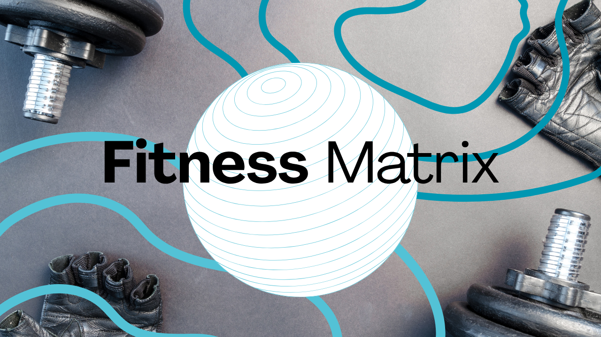
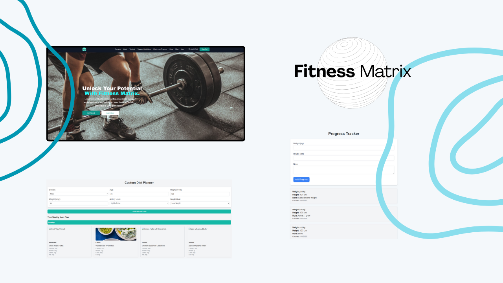
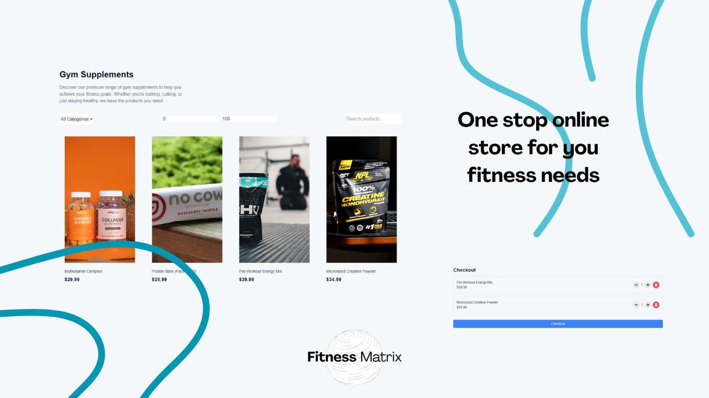
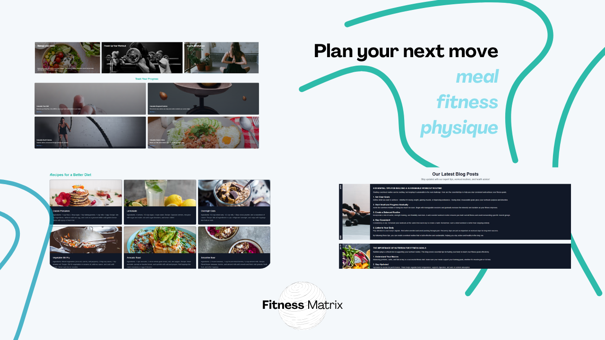

# Fitness Matrix — Full-Stack Health & Workout Tracking SaaS

## 📌 Project Overview

**Fitness Matrix** is a full-stack health and physical workout tracking web application designed to help users set fitness goals, record daily exercise routines, analyze caloric burn, and visualize overall body transformation over time.

Developed with the **MERN stack** (MongoDB, Express.js, React.js, and Node.js), Fitness Matrix turns workout logs into actionable visual analytics, enabling athletes and fitness enthusiasts to monitor personal records, workout consistency, and biometric milestones.

---

## 🔗 Key Links & Information

- **Live Application:** [fitnessmatrix.vercel.app](https://fitnessmatrix.vercel.app/)
- **GitHub Repository:** [github.com/AhmedAwsaf/Fitness_Matrix](https://github.com/AhmedAwsaf/Fitness_Matrix)
- **Author & Full-Stack Developer:** Ahmed Awsaf
- **Collaborators:**
  - [Ahmed Awsaf](https://www.linkedin.com/in/awsaf-ahmed)
  - [Zaima Mashiat](https://github.com/zaimamashiat)
  - Tasnia Taslim Hossain
  - [Shafkat Zahir](https://github.com/SafkatZ)

---

## 🛠️ Technical Implementation

- **Frontend:** React.js, Responsive CSS3 Grid/Flexbox, Recharts / Chart.js Data Visualization
- **Backend Framework:** Node.js runtime, Express.js microservices
- **Database:** MongoDB Atlas (NoSQL) with normalized schemas for workout logs, user metrics, and exercise databases
- **Authentication:** JWT (JSON Web Tokens) with encrypted password storage (bcrypt)
- **Deployment:** Vercel (Front-end hosting) with connected cloud database clusters

---

## ✨ Core Features

1. **Daily Workout Logging:** Rapid logging of exercise sets, repetitions, weights, and rest durations.
2. **Progress Analytics & Charts:** Visual time-series charts displaying strength gains, volume progression, and bodyweight changes.
3. **Exercise Library:** Categorized directory of weightlifting, cardiovascular, and flexibility movements with target muscle group indicators.
4. **Goal Setting & Streaks:** Gamified adherence tracker with workout streak counters to foster fitness habits.

---

## 📸 Media & Screenshots

| Dashboard Overview | Workout Logging Screen |
| :---: | :---: |
|  |  |

| Routine Planning | Exercise Database | Analytics & Metrics |
| :---: | :---: | :---: |
|  |  |  |
