# MASROORS PLLC — Production Landing Page & Admin Dashboard

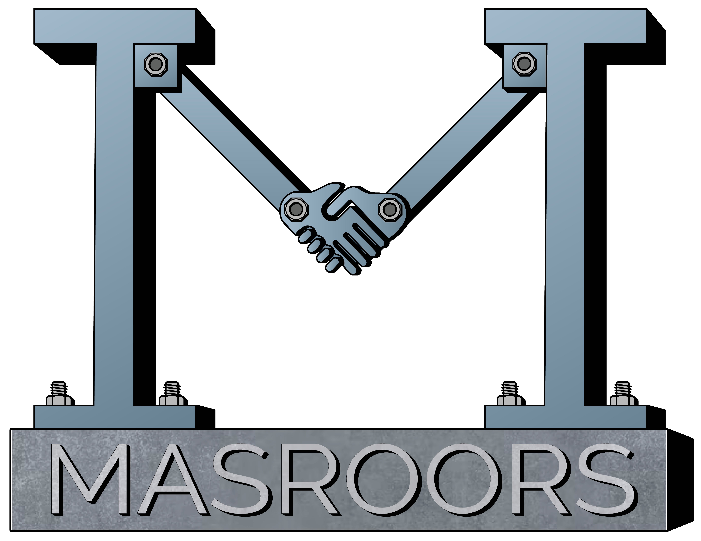

## 📌 Project Overview

**MASROORS PLLC** is a full-featured commercial web portal and secure administrative dashboard developed for a United States-based law firm headquartered in Chandler, Arizona. The platform serves as the digital front door for prospective clients seeking legal consultation while providing internal paralegals and attorneys with a central command center to manage case workflows, client documentation, and scheduling.

The system combines high-performance server-side rendering for the public storefront with a secured, authenticated administrative panel backed by cloud PostgreSQL and FastAPI microservices.

---

## 🔗 Key Links & Information

- **Official Live Website:** [masroors.com](https://www.masroors.com/)
- **Author & Full-Stack Developer:** Ahmed Awsaf
- **Client Organization:** Masroors PLLC (Chandler, AZ, USA)
- **Status:** Live in Production

---

## 🛠️ Technical Stack

- **Frontend Framework:** Next.js (React), TypeScript
- **Styling & UI:** Tailwind CSS, Lucide Icons, Responsive Mobile-First Design
- **Backend Services:** Python (FastAPI), Node.js, Express.js
- **Database Layer:** PostgreSQL (hosted via serverless NeonDB)
- **Authentication & Security:** JSON Web Tokens (JWT), Role-Based Access Control (RBAC), Firebase Auth
- **Hosting & Deployment:** Vercel (Frontend SSR) & Cloud Managed Backend Services

---

## ✨ Core Functionalities

1. **Modern Client-Facing Storefront:** Fast-loading, SEO-optimized landing pages explaining practice areas (Immigration, Business Law, Estate Planning) with integrated intake inquiry forms.
2. **Administrative Case Dashboard:** A private dashboard enabling legal staff to view real-time incoming leads, assign case statuses, and manage client milestones.
3. **Automated Reporting Queries:** Optimized SQL aggregation queries that summarize case throughput, document review backlogs, and client follow-up intervals.
4. **Secure Document & Data Handling:** Granular permissions ensuring confidential client records and sensitive legal paperwork remain inaccessible to unauthorized users.

---

## 📸 Media & Screenshots

### Dashboard & Interfaces

| Dashboard Overview | Consultation Portal | Administrative Console |
| :---: | :---: | :---: |
| 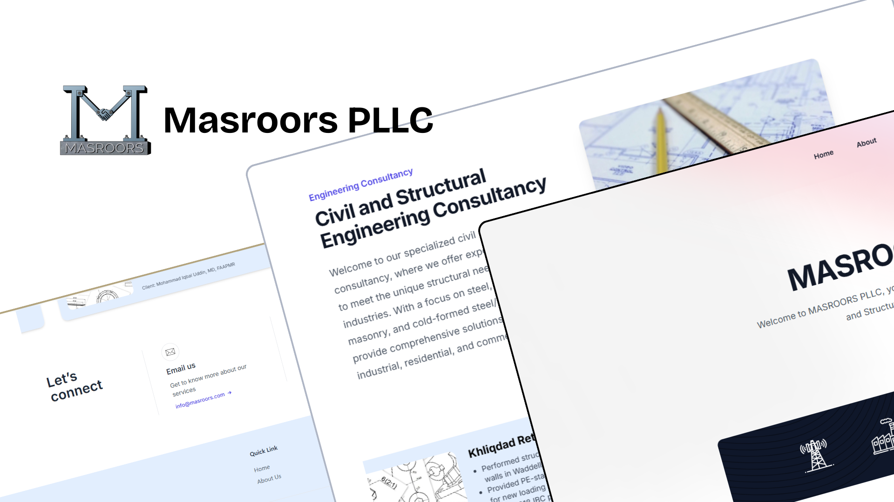 | 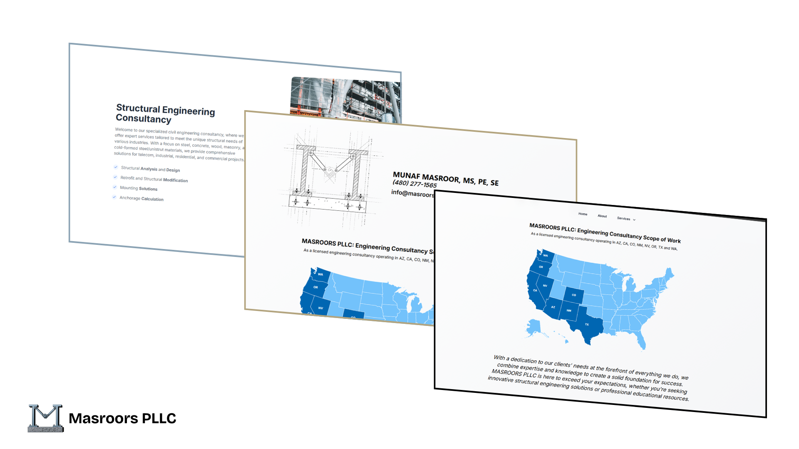 | 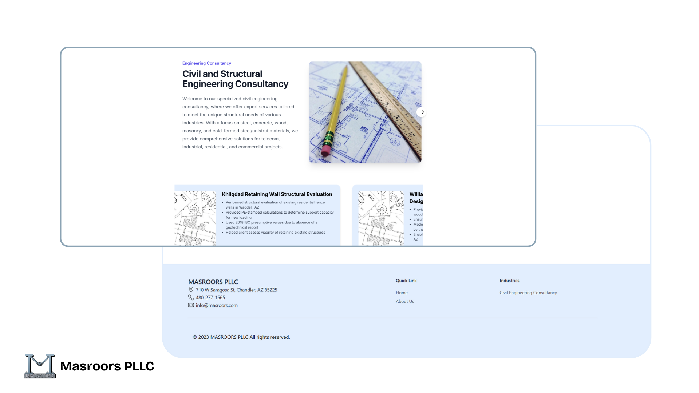 |

### Extended Production Screenshots

| Admin View E1 | Case Intake E2 | Status View E3 |
| :---: | :---: | :---: |
| 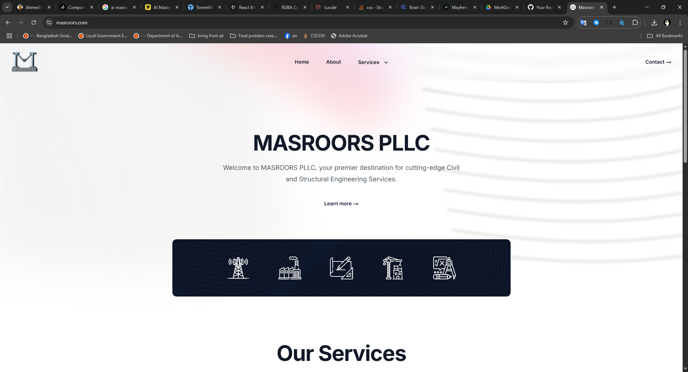 | 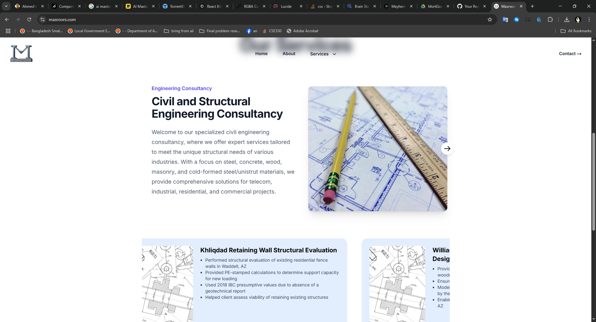 | 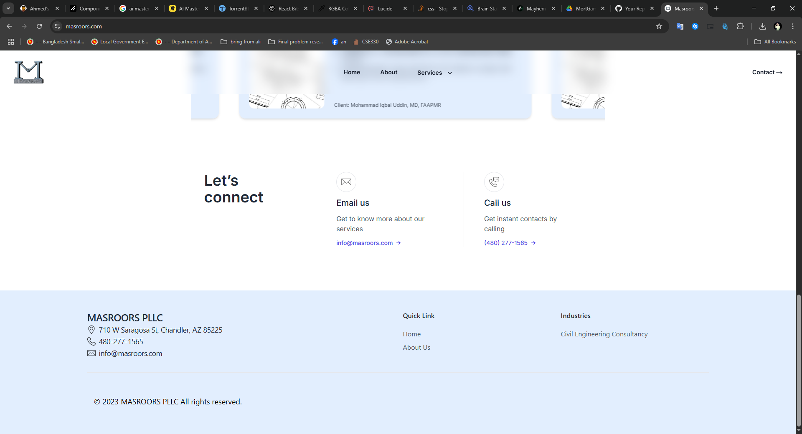 |

| Portal View E4 | Client Records E5 | Records E6 | Records E7 |
| :---: | :---: | :---: | :---: |
| 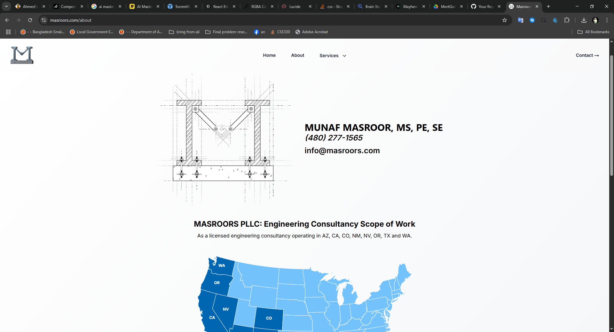 | 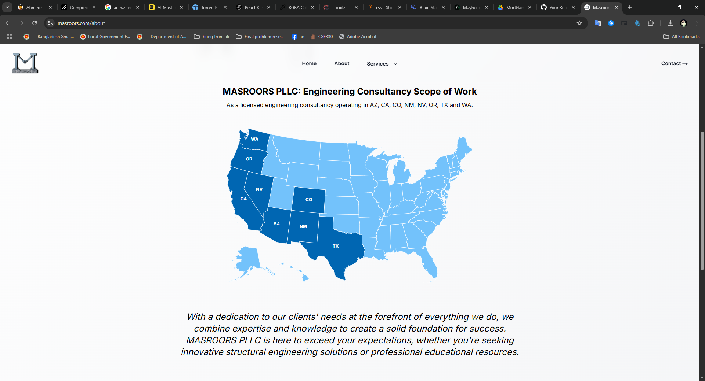 | 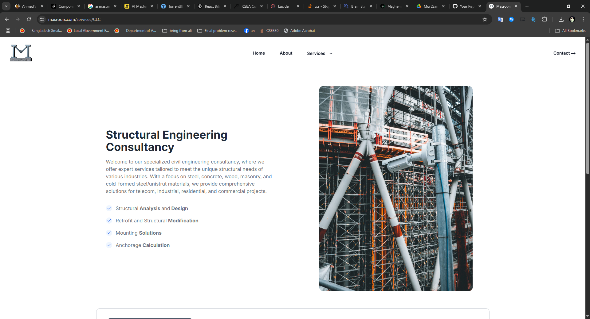 | 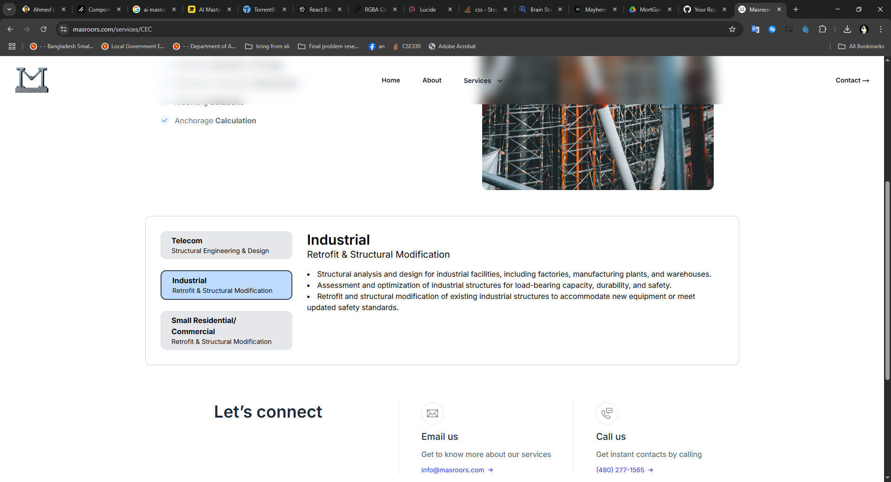 |
