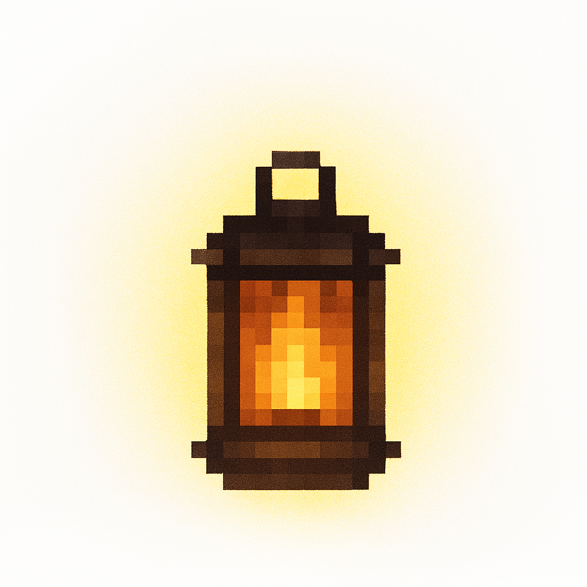
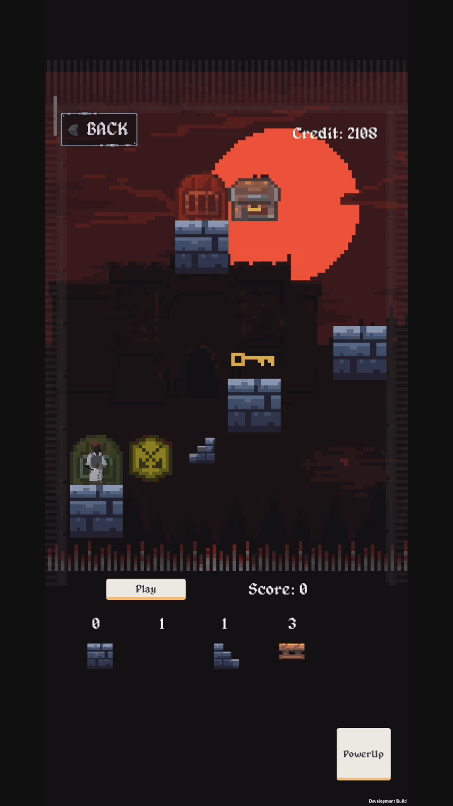
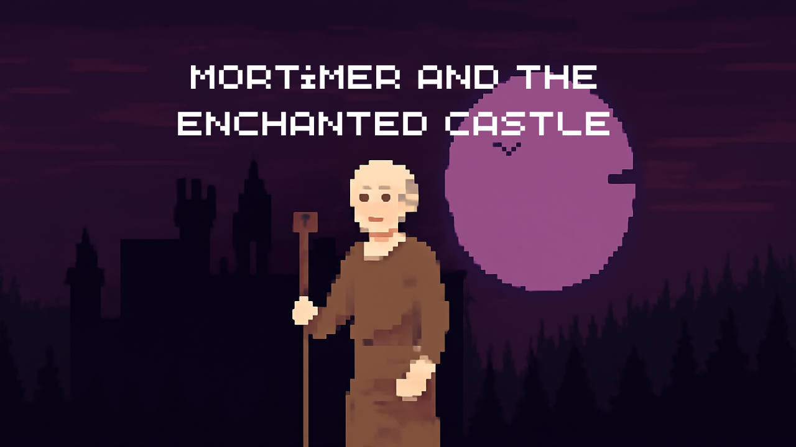
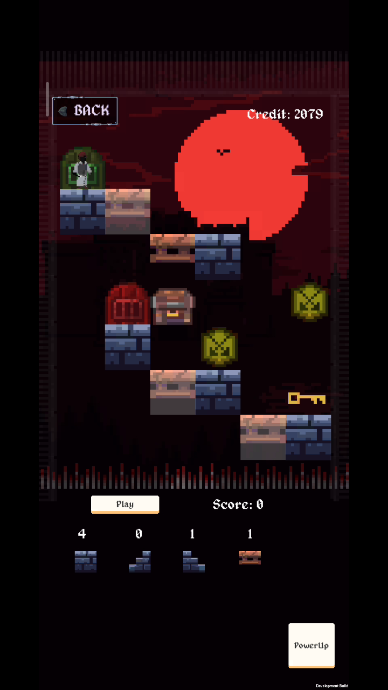
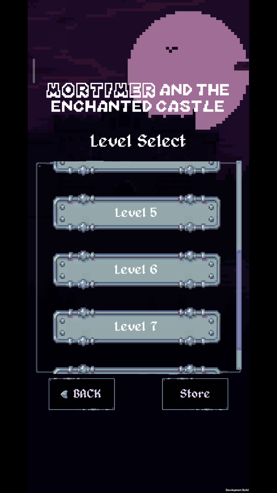
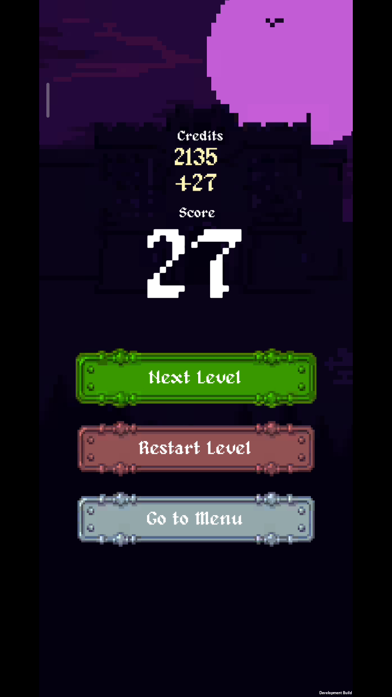
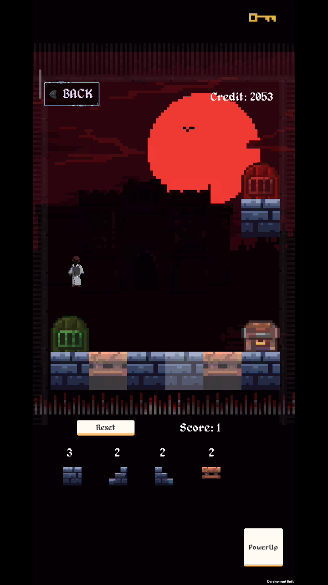
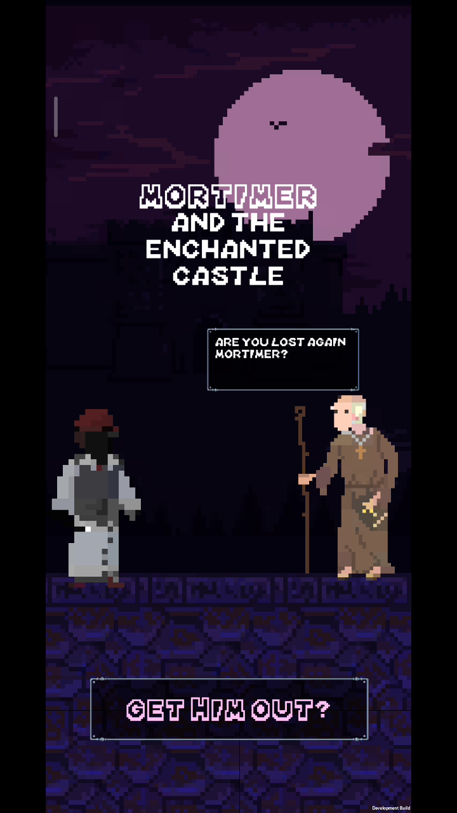
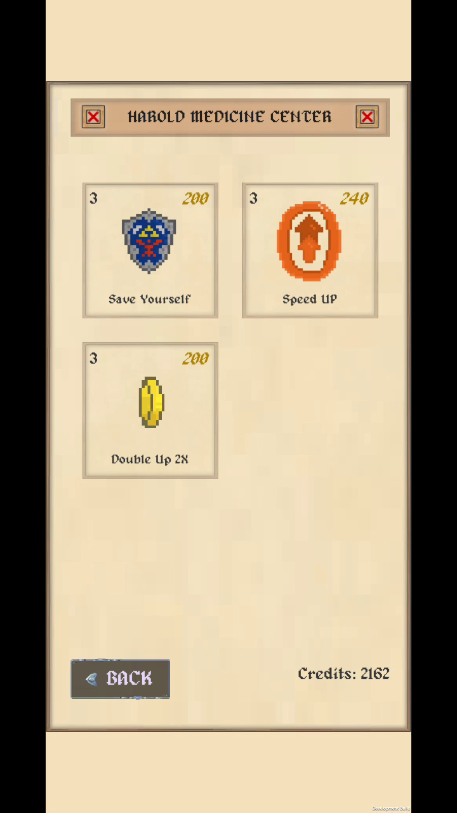
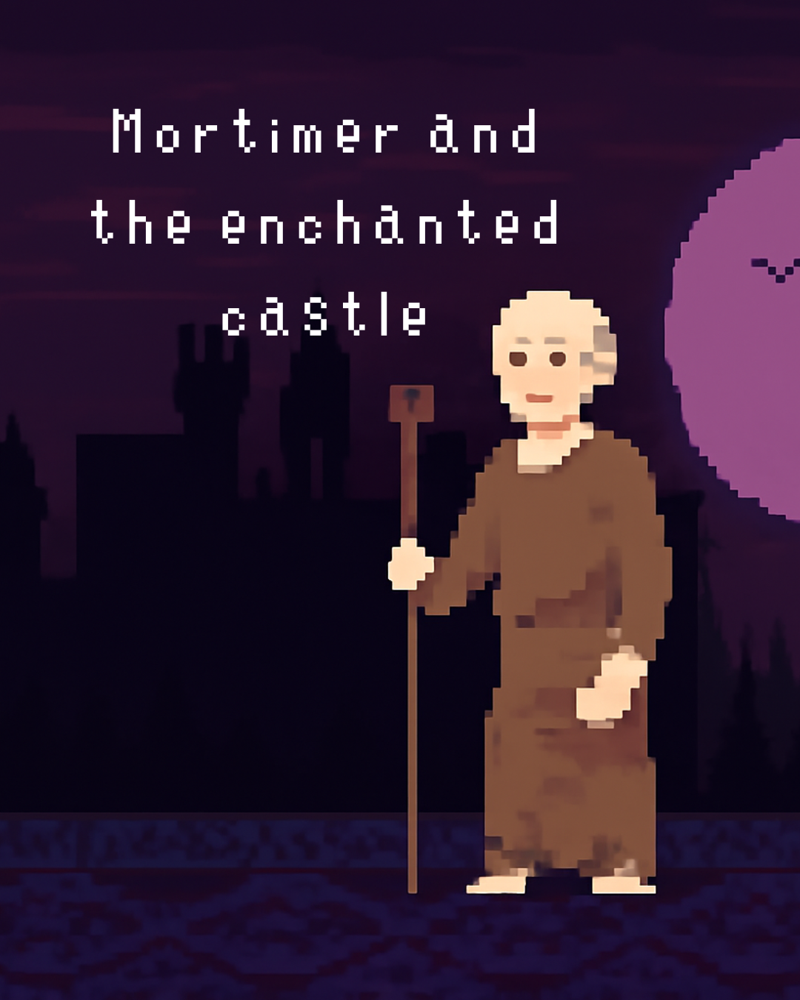

# MortGame — Android Mobile Game (Unity & C#)

## 📌 Project Overview

**MortGame** is a fast-paced 2D action/arcade mobile game developed from the ground up utilizing the **Unity Engine**, **C#**, and the **Android SDK**. Designed specifically for touchscreen devices, MortGame challenges players through progressive obstacle courses requiring precise timing, dynamic physics interactions, and quick reflexes.

The project encompassed complete lifecycle game development: concept ideation, character sprite design, 2D physics tuning, particle effects, sound design, UI state machines, and final Android APK compilation and performance profiling.

---

## 🔗 Key Links & Information

- **GitHub Repository:** [github.com/AhmedAwsaf/MortGAME](https://github.com/AhmedAwsaf/MortGAME)
- **Author & Solo Game Developer:** Ahmed Awsaf
- **Target Platform:** Android (Google Play / APK)
- **Engine & Languages:** Unity 2D, C#, Android SDK

---

## 🛠️ Technical Implementation

- **Game Engine:** Unity (2D Physics Engine, Rigidbody2D, BoxCollider2D, Raycasting)
- **Scripting Language:** C# (.NET framework)
- **Input System:** Unity Mobile Input Touch Controllers with multi-touch support
- **Animation System:** Mecanim state machines, frame-by-frame sprite sheets, particle emissions
- **Optimization:** Object pooling for projectile and obstacle spawning to avoid garbage collection hitches on low-end Android mobile hardware
- **Audio & UI:** Dynamic sound effects mixer, high-score persistence via local binary serialization

---

## ✨ Gameplay Features

1. **Responsive Mobile Touch Controls:** Tailored touch-and-drag gesture mechanics for immediate tactile feedback.
2. **Physics-Driven Obstacle Courses:** Interactive environmental hazards governed by velocity damping, gravitational shifts, and elastic bounce physics.
3. **Progressive Difficulty Scaling:** Algorithmic level generation that scales game speed and obstacle density as player survival time increases.
4. **Custom Audio-Visual FX:** Visual screen shakes, hit sparks, and celebratory win animations.

---

## 📸 Media, Gameplay GIFs & Screenshots

### Gameplay Animations

| Action Gameplay Loop | In-Game Mechanics Animation |
| :---: | :---: |
|  |  |

### Core Screenshots

| Stage 1 | Stage 2 | Stage 3 |
| :---: | :---: | :---: |
|  |  |  |

| Stage 4 | Stage 5 | Stage 6 |
| :---: | :---: | :---: |
|  |  |  |

| Stage 7 | Stage 8 | Stage 9 |
| :---: | :---: | :---: |
|  |  |  |

### Captured VLC Snaps & Recordings
- Screen recording archives available in project folder:
  - `../images/projects/MortGame/Screenrecorder-2025-06-24-21-39-02-596.mp4`
  - `../images/projects/MortGame/Screenrecorder-2025-06-24-21-43-45-650.mp4`
  - High-res frame captures: `vlcsnap-2025-06-24-22h26m52s494.png` through `vlcsnap-2025-06-24-22h33m41s109.png`
