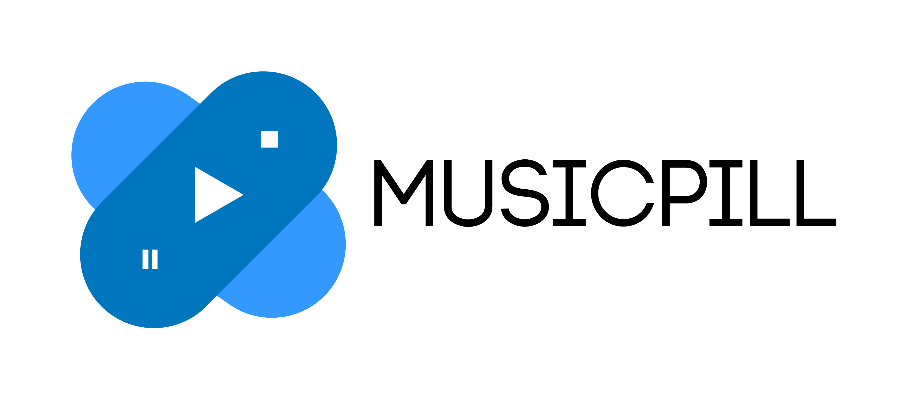
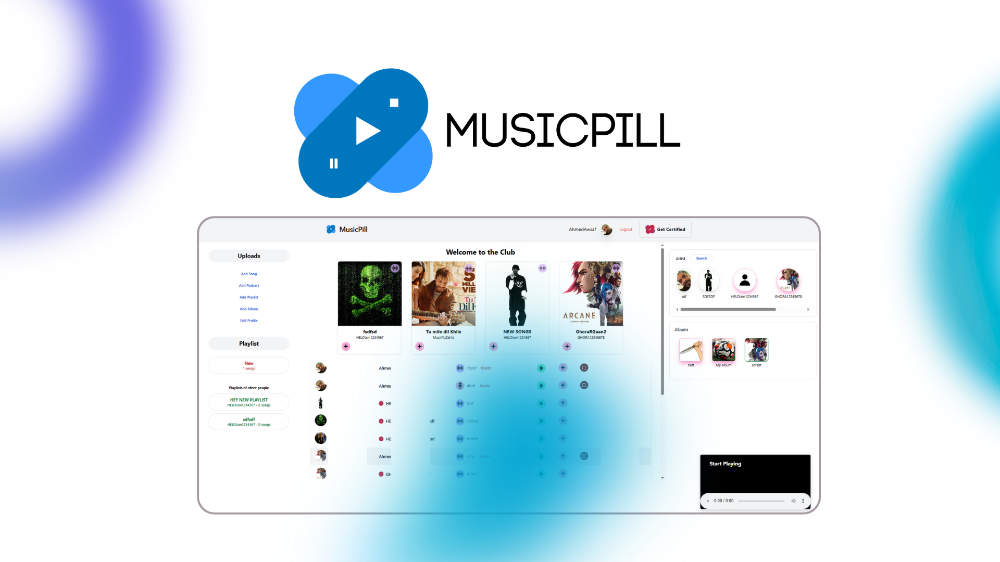
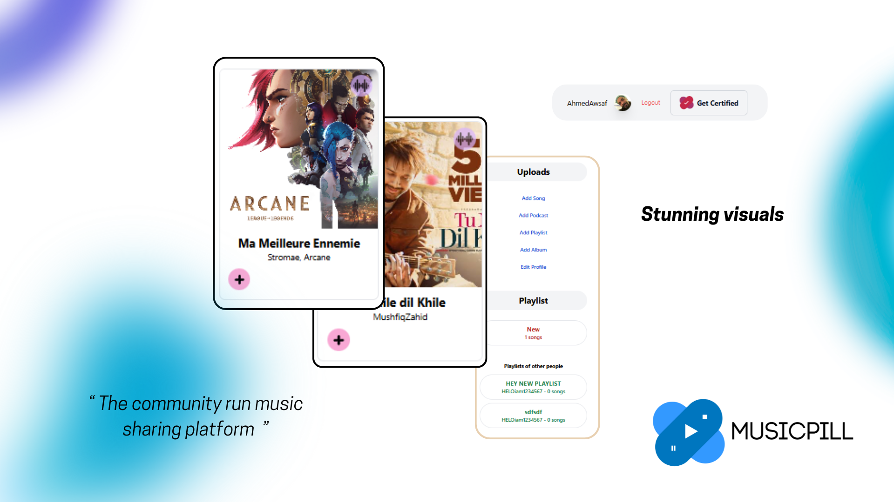
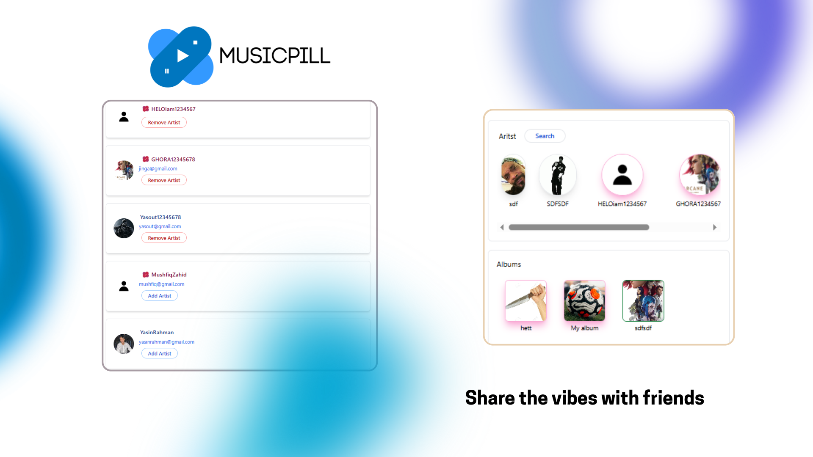

# MusicPill — Music Management & Playlist Web Application

## 📌 Project Overview

**MusicPill** is a personal music streaming and catalog management web application built with **Python**, the **Django web framework**, and a **MySQL relational database**. It provides music listeners with an organized personal audio library where they can curate tracks, create themed playlists, catalog artist discographies, and search their music collection with ease.

The project demonstrates strong server-side architecture using Django's Model-View-Template (MVT) pattern, relational database design with foreign key constraints, and dynamic client-side audio controls.

---

## 🔗 Key Links & Information

- **GitHub Repository:** [github.com/AhmedAwsaf/MusicPill](https://github.com/AhmedAwsaf/MusicPill)
- **Author & Solo Developer:** Ahmed Awsaf
- **Backend Stack:** Python, Django
- **Database:** MySQL

---

## 🛠️ Technical Architecture

- **Backend Framework:** Django (Python)
- **Database Management:** MySQL (Relational schema with normalized tables for Artists, Albums, Songs, and Playlists)
- **ORM:** Django ORM with optimized query sets to prevent N+1 query overhead
- **Frontend Templates:** Django Templates, HTML5 Audio API, CSS3, JavaScript
- **Static & Media Asset Handling:** Configured local and cloud storage handling for MP3 audio files and album artwork

---

## ✨ Core Features

1. **Custom Playlist Creation:** Create, edit, reorder, and delete custom playlists with instant track additions.
2. **Library Search & Filtering:** Fast query lookups across song titles, album names, and artist tags.
3. **HTML5 Audio Player:** Embedded, seamless persistent audio player with play/pause, seek bar, volume control, and shuffle/repeat modes.
4. **Relational Metadata Management:** Admin panel to manage record labels, release dates, track genres, and artist biographies.

---

## 📸 Media & Screenshots

| Interface Overview | Library Catalog | Playlist Player View |
| :---: | :---: | :---: |
|  |  |  |
