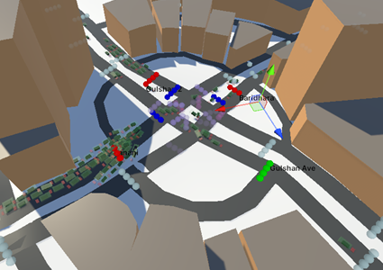
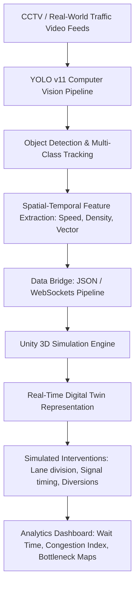

# Research & Publications — Ahmed Awsaf

## 📄 Publication Details

| Field | Description |
| :--- | :--- |
| **Title** | **Digital Twin Simulation for Traffic Infrastructure Management in Bangladesh** |
| **Document Type** | B.Sc. Capstone Thesis |
| **Year** | 2025 |
| **Institution** | Department of Computer Science and Engineering, BRAC University |
| **Repository** | Ayesha Abed Library Institutional Repository, BRAC University |
| **Permanent URI (Handle)** | [http://hdl.handle.net/10361/26321](http://hdl.handle.net/10361/26321) |
| **Citation** | Awsaf, A., Hossain, S., Hassan, P. T., Ramiz, Z., & Ul Islam, M. A. (2025). *Digital Twin Simulation for Traffic Infrastructure Management in Bangladesh*. Ayesha Abed Library Repository, BRAC University. |

---

## 🎯 Abstract & Executive Summary

Urban traffic congestion in developing nations like Bangladesh presents unique, highly non-linear challenges that traditional lane-based simulation models fail to accurately capture. Due to irregular vehicle movement patterns, heterogeneous traffic composition (bicycles, rickshaws, auto-rickshaws, buses, and private cars sharing the same road space), and lane indiscipline, conventional western traffic models break down.

This research formulates and implements a novel **Digital Twin Simulation framework** tailored specifically to the chaotic conditions of Bangladeshi traffic infrastructure. By coupling cutting-edge computer vision (**YOLO v11**) with the **Unity physics and game engine**, the system creates a live, high-fidelity virtual replica of physical intersections. This enables city planners and civil engineers to perform predictive simulation, bottleneck identification, and infrastructure stress-testing before breaking ground.

---

## 🔬 System Architecture & Methodology

### 1. Computer Vision Layer (YOLO v11)
- Utilized state-of-the-art YOLO v11 trained on custom Bangladeshi street datasets featuring localized vehicular classes (CNG three-wheelers, legunas, cycle rickshaws, and non-standard buses).
- Tracked vehicles frame-by-frame using centroid tracking and Kalman filter state estimation to compute velocity vectors, headway distance, and lane-crossing violations.

### 2. Digital Twin Modeling in Unity
- Built a 3D simulation environment in Unity using C#, recreating high-density Dhaka road intersections with realistic road textures, geometric elevations, and collision boundaries.
- Fed real-world coordinates and traffic flow rates into Unity to spawn agent instances that mirror the real-time physical state of the target roads.

### 3. Simulation & Scenario Testing
- Simulated hypothetical infrastructural alterations:
  - Dynamic traffic light timing adjustments based on real-time vehicle density.
  - Physical lane dividers separating motorized and non-motorized vehicles.
  - Automated rerouting suggestions during peak congestion.

---

## 💡 Key Contributions & Findings

1. **Heterogeneous Traffic Adaptation:** Successfully resolved the mismatch between standard homogeneous traffic models (which assume strict lane following) and non-lane-based traffic behaviors typical of South Asian cities.
2. **Computational Efficiency:** Leveraged YOLO v11's optimized inference speeds to run tracking pipelines on standard hardware without requiring supercomputing clusters.
3. **Interactive Visual Feedback:** Provided urban planners with a visual, intuitive 3D representation alongside quantitative congestion analytics.
4. **Archived Academic Work:** The research paper and full documentation are officially cataloged in the BRAC University institutional repository under permanent handle `10361/26321`.

---

## 🛠️ Research Tech Stack

- **Computer Vision:** YOLO v11, OpenCV, Python
- **Simulation Engine:** Unity Engine, C#, Android SDK
- **Data Analytics:** Pandas, NumPy, Matplotlib
- **Network Pipeline:** WebSockets / REST API protocols for synchronizing vision outputs with 3D agents
